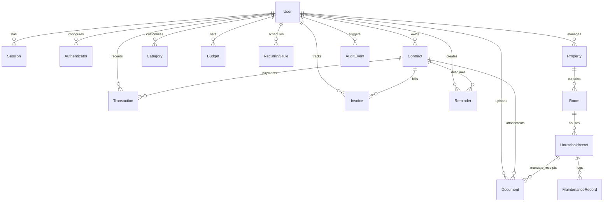

# Akata Life — Technical Architecture (`ARCHITECTURE.md`)

## 1. Architectural Overview

**Akata Life** is a modular, monolithic full-stack web application designed for private self-hosting on a single VPS using Docker Compose. It prioritizes **data integrity**, **strict server-side authorization**, **zero public exposure of sensitive documents or database ports**, and **German/Turkish localization**.

```mermaid
flowchart LR
    Client["iPhone PWA / Desktop Browser"] -->|HTTPS| Proxy["Reverse Proxy (Caddy / Nginx)"]
    Proxy -->|Internal HTTP :3000| App["Next.js App Router Server (Node.js)"]
    App -->|Prisma ORM (Private Bridge)| DB[("PostgreSQL 16")]
    App -->|Authorized Stream| Storage[("Private Document Volume (/data/uploads)")]
    App -.->|Optional Server-Side HTTPS| HA["Home Assistant API (Read-Only)"]
```

---

## 2. Technology Stack

| Layer | Technology | Rationale |
| :--- | :--- | :--- |
| **Framework** | Next.js (App Router, TypeScript strict) | Unified server-rendered UI, Server Actions, and API routes for binary document streaming and health checks. |
| **Styling & UI** | Tailwind CSS + Radix UI / shadcn-compatible components + Lucide Icons | Accessible keyboard navigation, clean light/dark theme tokens, responsive mobile-first layouts without heavy runtime overhead. |
| **Charts** | Recharts | Composable, responsive SVG charts backed directly by database aggregates. |
| **Forms & Validation** | React Hook Form + Zod | Shared client/server schema validation with localized error messages (`de` / `tr`). |
| **Database & ORM** | PostgreSQL 16 + Prisma ORM | Strict relational integrity, version-controlled SQL migrations, and `Decimal(12,2)` / integer minor-unit precision. |
| **Authentication** | Custom Database Session + Argon2id (`@node-rs/argon2` / `oslo`) + TOTP (`otpauth`) | Full control over session revocation, rate limiting, HTTP-only secure cookies, and zero third-party auth vendor lock-in. |
| **Testing** | Vitest (Unit/Integration) + Playwright (E2E) | Fast domain logic verification (money math, deadlines, auth guards) and full browser journey testing. |

---

## 3. Financial & Date Integrity Rules

1. **No Floating-Point Money Math:**
   - Database columns store monetary amounts as ` integer` minor units (`amountCents`) or `Decimal(12, 2)`.
   - All arithmetic in TypeScript uses integer minor units (cents) and converts to formatted strings only at the presentation layer.
2. **German Localization Defaults (`de-DE` & `tr-TR`):**
   - Time zone: `Europe/Berlin`
   - Date display: `DD.MM.YYYY` (`Intl.DateTimeFormat('de-DE', { timeZone: 'Europe/Berlin' })`)
   - Currency display: `1.234,56 €` (`Intl.NumberFormat('de-DE', { style: 'currency', currency: 'EUR' })`)
   - Input parser accepts both German comma (`123,45`) and standard dot (`123.45`) decimal inputs safely.

---

## 4. Security Architecture

### 4.1 Authentication & Session Management
- **Single-User Owner Model (Extensible to Household Members):** Public registration is disabled. The initial owner account is provisioned via a secure CLI/seed bootstrap script using environment secrets.
- **Password Hashing:** Argon2id with strong memory/time cost parameters.
- **TOTP Multi-Factor Authentication:** Standard RFC 6238 TOTP (`otpauth`) with encrypted secret storage and recovery codes.
- **Login Rate Limiting:** Database/memory-backed sliding window limiter per IP and email to block brute-force attempts, logged in `AuditEvent`.
- **Sessions:** Stored in the `Session` table with SHA-256 hashed session tokens, `HttpOnly`, `SameSite=Lax`, `Secure` (in production) cookies, explicit expiration, and instant server-side revocation.

### 4.2 Private Document Storage
- Uploaded files are stored **outside** the Next.js `public/` and source directories (e.g., `./storage/uploads` locally, `/var/lib/akatalife/uploads` in Docker volume).
- **Upload Validation Pipeline:**
  1. Verify active user session.
  2. Enforce maximum file size (default 25 MB).
  3. Validate file extension and declared MIME type (`application/pdf`, `image/jpeg`, `image/png`, `image/webp`).
  4. Verify file magic bytes (file signature header) to prevent disguised executables or HTML/SVG XSS payloads.
  5. Generate a random UUID storage key (`<uuid>.<ext>`); store original filename only as sanitized metadata in PostgreSQL.
- **Download & Preview Pipeline:**
  - Served exclusively through an authenticated route (`/api/documents/[id]/file`) with `Content-Security-Policy: default-src 'none'`, `X-Content-Type-Options: nosniff`, and strict path normalization checks against the storage root.

---

## 5. Relational Data Model Summary



---

## 6. Directory Structure

```text
akatalife/
├── MASTER_PROMPT.md          # Complete project specification
├── ROADMAP.md                # Living milestone tracker
├── ARCHITECTURE.md           # Technical architecture & design decisions
├── SECURITY.md               # Security controls, threat model, secret handling
├── DEPLOYMENT.md             # VPS inspection & Docker Compose deployment guide
├── BACKUP_RESTORE.md         # Backup automation & verified restore runbook
├── prisma/
│   ├── schema.prisma         # Normalized relational schema
│   ├── migrations/           # Version-controlled SQL migrations
│   └── seed.ts               # Development-only seed script
├── src/
│   ├── app/                  # Next.js App Router pages & API routes
│   ├── components/           # Accessible UI & domain components
│   ├── lib/
│   │   ├── auth/             # Session, Argon2id, TOTP, rate-limiter, guards
│   │   ├── db/               # Prisma singleton client
│   │   ├── finance/          # Integer-cent / Decimal arithmetic & deadline calculators
│   │   ├── format/           # German/Turkish date & EUR currency formatters
│   │   ├── i18n/             # Dedicated de.ts and tr.ts localization dictionaries
│   │   └── storage/          # Secure private document storage & magic-byte validator
│   └── types/                # Shared strict TypeScript definitions
├── tests/
│   ├── unit/                 # Vitest unit & domain logic tests
│   └── e2e/                  # Playwright end-to-end user journey tests
├── scripts/
│   ├── backup.sh             # PostgreSQL + uploads backup with SHA-256 manifest
│   └── restore.sh            # Verified restore script
├── Dockerfile                # Multi-stage production container
└── docker-compose.yml        # Local & production container orchestration
```

---

## 7. Unresolved Environment & Deployment Questions (To Confirm Before Milestone 5)

1. **Local Development Runtime:** Does this macOS machine have Node.js / Homebrew / Docker installed outside the default sandbox paths (`/opt/homebrew`), or should we verify tool access outside the sandbox first?
2. **VPS Target (Milestone 5):** When we reach Milestone 5, we will inspect your VPS non-destructively to confirm the Linux distribution, existing reverse proxy (Nginx, Caddy, or Traefik), available ports, and domain name. No production infrastructure will be touched until then.
