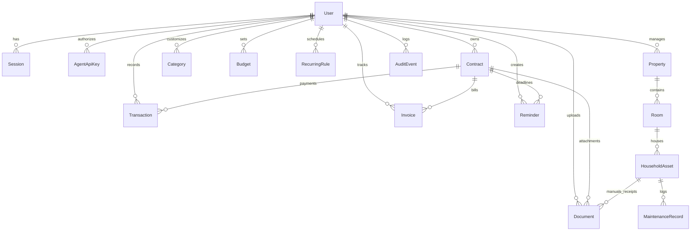

# Akata Life — Technical Architecture (`ARCHITECTURE.md`)

## 1. Architectural Overview

**Akata Life** is a modular, production-oriented full-stack web application deployed via **GitHub + Coolify**, backed by **Supabase PostgreSQL**, and equipped with a dedicated **Hermes Agent API (`/api/v1/agent/*`)** so that **Hermes Agent** has full programmatic read/write capabilities across all household modules alongside the human web/PWA interface.

```mermaid
flowchart LR
    Client["iPhone PWA / Desktop Browser"] -->|HTTPS| Coolify["Coolify Reverse Proxy (Traefik/Caddy)"]
    Hermes["Hermes Agent"] -->|HTTPS + Bearer API Key| Coolify
    Coolify -->|Internal HTTP :3000| App["Next.js App Router Server (Node.js)"]
    App -->|Prisma ORM (DATABASE_URL / DIRECT_URL)| Supabase[("Supabase PostgreSQL")]
    App -->|Authorized Stream| Storage[("Private Document Storage (Coolify Volume / Supabase Storage)")]
    App -.->|Optional Server-Side HTTPS| HA["Home Assistant API (Read-Only)"]
```

---

## 2. Technology Stack

| Layer | Technology | Rationale |
| :--- | :--- | :--- |
| **Framework** | Next.js (App Router, TypeScript strict) | Unified server-rendered UI, Server Actions, and REST API endpoints for both browser sessions and Hermes Agent. |
| **Deployment** | GitHub + Coolify (`Dockerfile` standalone build) | Push-to-deploy from GitHub with Coolify managing TLS certificates, container healthchecks (`/api/health`), and persistent volumes. |
| **Database & ORM** | Supabase PostgreSQL + Prisma ORM | Managed PostgreSQL reliability with `DATABASE_URL` (connection pooler) and `DIRECT_URL` (migrations), strict relational integrity, and integer minor-unit precision. |
| **Hermes Agent Access** | REST API (`/api/v1/agent/*`) + OpenAPI 3.1 Spec (`/api/v1/agent/openapi.json`) | Gives Hermes Agent full CRUD access to contracts, documents, transactions, invoices, reminders, home inventory, and dashboard summaries using Bearer token auth. |
| **Styling & UI** | Tailwind CSS + Accessible UI primitives + Lucide Icons | Clean light/dark theme tokens, responsive mobile-first layouts for iPhone PWA and desktop. |
| **Charts** | Recharts | Composable, responsive SVG charts backed directly by database aggregates. |
| **Forms & Validation** | React Hook Form + Zod | Shared schema validation for both UI forms and Hermes Agent JSON payloads. |
| **Authentication** | Database Session + Argon2id/scrypt + TOTP (`otpauth`) + Scoped Agent API Keys | Human sessions via `HttpOnly` cookies; Hermes Agent via SHA-256 hashed Bearer API keys (`HERMES_AGENT_API_KEY`). |
| **Testing** | Vitest (Unit/Integration) + Playwright (E2E) | Fast domain logic verification (money math, deadlines, auth guards, Hermes Agent API endpoints) and full browser journey testing. |

---

## 3. Hermes Agent Integration Architecture (`/api/v1/agent/*`)

Hermes Agent is a first-class citizen of Akata Life. Every domain service (`contracts`, `documents`, `transactions`, `invoices`, `reminders`, `home`, `dashboard`) is implemented in a clean service layer (`src/lib/services/*`) shared by both:
1. **Next.js UI / Server Actions** (authenticated via user session cookie)
2. **Hermes Agent API (`/api/v1/agent/*`)** (authenticated via `Authorization: Bearer <HERMES_AGENT_API_KEY>` or database-managed `AgentApiKey`)

### Hermes Agent Endpoints
- `GET /api/v1/agent/openapi.json` — Machine-readable OpenAPI 3.1 / tool schema so Hermes Agent automatically discovers all endpoints, parameters, and schemas.
- `GET /api/v1/agent/summary` — Complete household snapshot (current month income/expenses/budget, upcoming bills, expiring contracts, pending reminders, recent documents).
- `GET | POST /api/v1/agent/contracts` & `GET | PATCH | DELETE /api/v1/agent/contracts/[id]` — Full contract management & deadline calculation.
- `GET | POST /api/v1/agent/documents` & `GET | PATCH | DELETE /api/v1/agent/documents/[id]` — Document metadata CRUD, search, and multipart/base64 file upload & authorized download.
- `GET | POST /api/v1/agent/transactions` & `GET | PATCH | DELETE /api/v1/agent/transactions/[id]` — Income & expense recording and filtering.
- `GET | POST /api/v1/agent/invoices` & `GET | PATCH | DELETE /api/v1/agent/invoices/[id]` — Invoice tracking, marking bills as paid, recurring bill generation.
- `GET | POST /api/v1/agent/reminders` & `GET | PATCH | DELETE /api/v1/agent/reminders/[id]` — Reminder management & completion.
- `GET | POST /api/v1/agent/home` — Property, rooms, household assets, maintenance records, and meter readings.

### Security & Auditability for Hermes Agent
- Constant-time token comparison (`crypto.timingSafeEqual`) against SHA-256 hashed keys.
- All mutations performed by Hermes Agent automatically write an `AuditEvent` record with `actorType: "HERMES_AGENT"` so the owner can see every action Hermes Agent took in the UI (`Backup & Systemstatus` / Audit Log).

---

## 4. Financial & Date Integrity Rules

1. **No Floating-Point Money Math:**
   - Database columns store monetary amounts as integer minor units (`amountCents`) or `Decimal(12, 2)`.
   - All arithmetic in TypeScript uses integer minor units (cents) and converts to formatted strings only at the presentation layer.
2. **German Localization Defaults (`de-DE` & `tr-TR`):**
   - Time zone: `Europe/Berlin`
   - Date display: `DD.MM.YYYY` (`Intl.DateTimeFormat('de-DE', { timeZone: 'Europe/Berlin' })`)
   - Currency display: `1.234,56 €` (`Intl.NumberFormat('de-DE', { style: 'currency', currency: 'EUR' })`)
   - Input parser accepts both German comma (`123,45`) and standard dot (`123.45`) decimal inputs safely.

---

## 5. Relational Data Model Summary (Supabase PostgreSQL)


